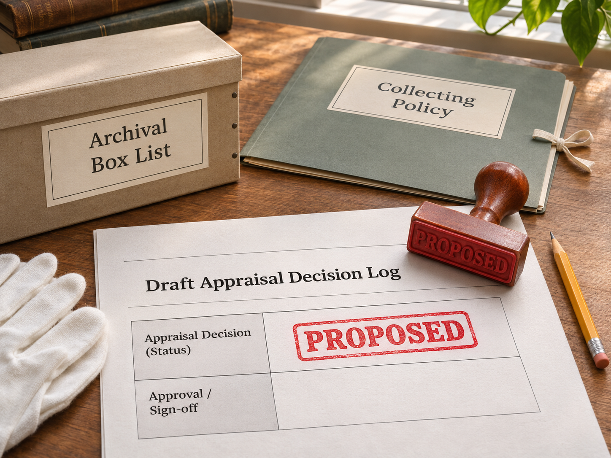

# Appraisal Decision Log skill



This guide helps an AI agent work with an archivist or records manager to document why records are being considered for retention, sampling, transfer, further review or disposal.

## Install with your AI agent

Copy and paste this into your agent:

```text
Install the Appraisal Decision Log skill from https://github.com/matthewbrutonall/appraisal-decision-log in your skills directory. Keep its SKILL.md and other repository files together, then confirm that you can use the skill for an appraisal decision log. This skill does not require the separate CLI; do not install the CLI unless I ask.
```

The agent can organise supplied evidence, explain a proposed action and show what still needs checking. The draft does not approve or carry out any action on the records. Final decisions require the institution's authorised process.

The skill is a standalone Markdown guide. It has no executable code. For repeatable local CSV, Markdown and JSON reports, the separate [Appraisal Decision Log CLI](https://github.com/matthewbrutonall/appraisal-decision-log-cli) is available but optional.
